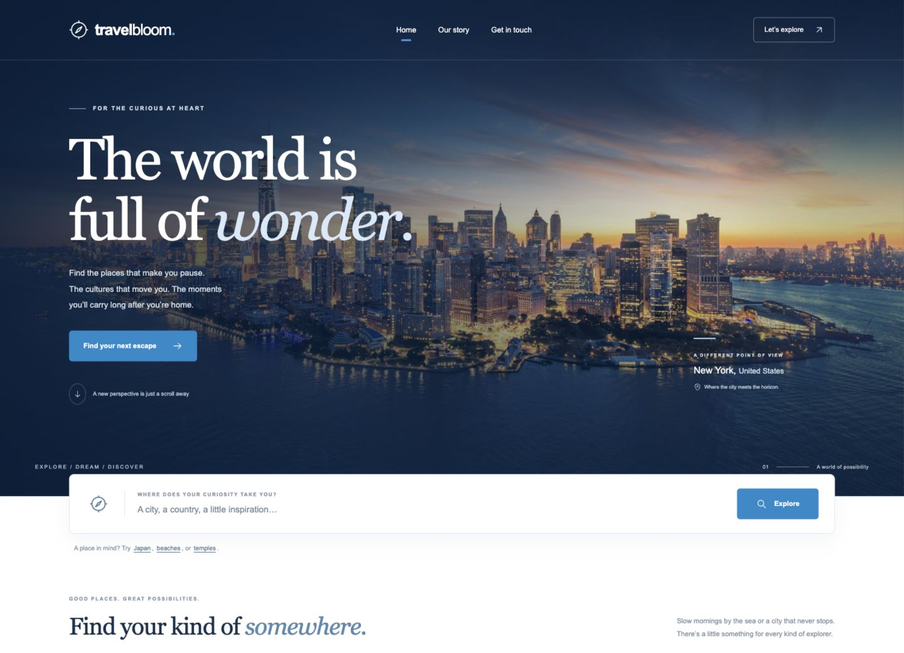

# TravelBloom

A little curiosity. A whole world to discover.

TravelBloom is a responsive travel discovery portfolio project by [Francis Martinez](https://github.com/franxis12), built with HTML, CSS, and vanilla JavaScript.



## Explore

- Search the original collection of 10 destinations by city, country, description, or category.
- Browse beaches, city escapes, and cultural landmarks.
- Open destination details and continue to Google Maps.
- Read the project story and view photo credits.
- Preview or copy a contact message. The contact form is explicitly a demo: it does not send or store messages.

The redesign preserves the original navy (`#0a2846`), blue (`#188acd`), and white palette. It includes mobile navigation, keyboard focus states, a native accessible dialog, reduced-motion support, empty/error states, and local destination photographs.

## Run locally

No dependencies or build step are required. Serve the folder with a static server:

```sh
python3 -m http.server 8000
```

Open <http://localhost:8000>. Use a local server rather than opening HTML files directly, because the site uses JavaScript modules and fetches its destination collection.

## Verify

With Node.js 20 or newer:

```sh
npm test
```

Tests cover destination preservation, city/country matching, accent-insensitive searches, singular/plural category keywords, filters, empty results, and local image availability.

## Publish

Serve the repository root with GitHub Pages or another static HTTPS host. All page and asset paths are relative, so deployment under a repository subdirectory works without configuration.

## Photography

The original project's image sources are preserved as `imageSourceUrl` in `travel_recommendation_api.json` and listed on the About page. The hero retains the original [New York photograph](https://www.agoda.com/wp-content/uploads/2024/02/Manhattan-USA.jpg).

The unavailable Melbourne image has been replaced with [Melbourne yarra afternoon by Diliff](https://commons.wikimedia.org/wiki/File:Melbourne_yarra_afternoon.jpg), under [CC BY 2.5](https://creativecommons.org/licenses/by/2.5/). It is displayed at a smaller size with no creative edits. Photographs belong to their respective creators.
